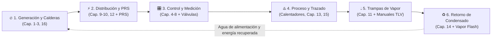

DML INGENIEROS CONSULTORES · PORTAL TÉCNICO CORPORATIVO
<h2>Biblioteca de Ingeniería de Vapor y Sistemas Térmicos</h2>

Plataforma centralizada de consulta, diseño y especificación técnica para ingenieros y clientes de <strong>DML Ingenieros Consultores</strong>. Integra manuales internacionales, criterios de dimensionamiento, hojas de datos corporativas y catálogos CAD/BIM 3D.

141
Documentos Técnicos

8
Colecciones de Ingeniería

4
Mapas Temáticos (MOC)

XLSX + 3D
Data Sheets y Modelos BIM

> [!TIP] Navegación Inteligente y Búsqueda Instantánea
> Presiona `Ctrl + K` (o utiliza el buscador en el panel izquierdo) para localizar al instante cualquier ecuación, norma, modelo de válvula, presión de diseño o manual técnico dentro de los 141 documentos. Para ver el catálogo completo en una sola vista, abre el **[[000_Indice_Principal|Índice Maestro de la Biblioteca]]**.

---

## 🔄 Arquitectura Lógica del Ciclo de Vapor y Condensado

Toda la biblioteca está organizada siguiendo la secuencia física real de una planta de vapor industrial, desde la generación en calderas hasta la recuperación del condensado:

---

## 🧭 Módulos Técnicos por Especialidad

Módulo 01 · Generación

### 🔥 Calderas y Energía Térmica

Termodinámica del vapor, calderas pirotubulares y acuotubulares, tratamiento de agua, control de TDS, purgas y desaireación presurizada.

- **Mapa temático**: [[MOC_Generacion_y_Energia|MOC Generación y Energía]]
- [[2.1 Engineering units|Principios de Ingeniería del Vapor (Cap. 2)]]
- [[3.1 Introduction|Sala de Calderas y Auxiliares (Cap. 3)]]
- [[16.1 Equations|Formulario y Ecuaciones de Diseño (Cap. 16)]]

Módulo 02 · Alta a Baja Presión

### ⚡ Distribución, PRS y Seguridad

Diseño de tuberías principales, drenaje, expansión térmica, válvulas de seguridad y estaciones reductoras de presión (caso práctico 150 → 25 psig).

- **Investigación DML**: [[EstacionesReductoras|Estaciones Reductoras de Presión (PRS)]]
- [[10.2 Pipes and pipe sizing|Dimensionamiento de Tuberías (Cap. 10)]]
- [[9.1 Introduction to safety valves|Válvulas de Seguridad (Cap. 9)]]
- [[12.1 Isolation valves (linear movement)|Accesorios de Tubería y Filtros (Cap. 12)]]

Módulo 03 · Instrumentación

### 🎛️ Control, Válvulas y Medición

Teoría de lazos PID, dimensionamiento de válvulas de control para vapor y agua, actuadores neumáticos/eléctricos, controles auto-operados y caudalímetros.

- **Mapa temático**: [[MOC_Control_y_Valvulas|MOC Control, Válvulas e Instrumentación]]
- [[6.4 Control valve sizing for steam systems|Dimensionamiento de Válvulas en Vapor (Cap. 6.4)]]
- [[7.1 Self-acting temperature controls introduction|Controles Auto-Actuados (Cap. 7)]]
- [[4.2 Principles of flowmetering|Medición de Flujo de Vapor (Cap. 4)]]

Módulo 04 · Transferencia Térmica

### ♨️ Calentadores de Agua y Trazado

Paquetes instantáneos vapor-agua (Spirax EasiHeat, TLV SteamAqua, Armstrong, AERCO), análisis de *stall* en intercambiadores y guías de *steam tracing*.

- **Investigación DML**: [[CalentadorAgua|Calentadores Instantáneos de Agua a Vapor]]
- [[13.1 Heat exchangers and stall|Intercambiadores y Fenómeno de Stall (Cap. 13)]]
- [[Steam Tracing Guide Line|Guía de Diseño de Trazadores de Vapor]]
- [[Tracing Steam  for Vessel|Trazado de Vapor para Recipientes]]

Módulo 05 · Drenaje y Eficiencia

### 💧 Trampas de Vapor (Steam Traps)

Criterios de selección de trampas mecánicas (flotador/balde), termostáticas y termodinámicas, venteo de aire, detección de fugas y catálogos TLV.

- **Mapa temático**: [[MOC_Trampas_y_Trazadores|MOC Trampas de Vapor y Trazadores]]
- [[11.5 Considerations for selecting steam traps|Criterios de Selección de Trampas (Cap. 11.5)]]
- [[Trampaflotador paraintercambiador 2|Trampas de Flotador Libre TLV para Proceso]]
- [[Trampa termodinamica para trazadores|Trampas Termodinámicas TLV para Trazado]]

Módulo 06 · Recuperación

### ♻️ Ciclo y Retorno de Condensado

Cálculo de líneas de retorno con flujo bifásico, recuperación de vapor flash, bombas mecánicas de condensado y casos reales de planta.

- **Mapa temático**: [[MOC_Ciclo_Condensado|MOC Ciclo de Vapor y Condensado]]
- [[14.3 Sizing condensate retrun lines|Dimensionamiento de Retorno de Condensado (Cap. 14.3)]]
- [[14.6 Flash steam|Recuperación de Vapor Flash (Cap. 14.6)]]
- [[Loop de Vapor & Condensado - 2015  Colgate|Caso Aplicado: Loop Vapor y Condensado Industrial]]

---

## 📋 Herramientas de Ingeniería DML: Data Sheets y Manuales Maestros

Acceso directo a las plantillas de especificación técnica en Excel (`.xlsx`) desarrolladas para proyectos de **DML Ingenieros Consultores**, junto con los manuales de referencia de fabricantes:

| Categoría | Código / Referencia | Descripción Técnica | Acceso Directo |
|---|---|---|---|
| **Hoja de Datos Excel** | `DS-CAL-001` | Plantilla de especificación para **Calentador Instantáneo de Agua a Vapor** (tipo EasiHeat) | [[HojasDeDatos\|Abrir Central de Data Sheets]] |
| **Hoja de Datos Excel** | `DS-PRS-001` | Plantilla de especificación para **Estación Reductora de Presión de Vapor** (caso 150 → 25 psig) | [[HojasDeDatos\|Abrir Central de Data Sheets]] |
| **Modelos CAD / BIM 3D** | `STEP / RFA / DWG` | Portales de descarga 3D (TraceParts, BIMobject, 3Dfindit) para calentadores y estaciones PRV | [[CalentadorAgua#Modelos 3D CAD / BIM descargables\|CAD Calentadores]] · [[EstacionesReductoras\|CAD PRS]] |
| **Manual Maestro** | `Spirax Sarco` | Manual de instalaciones típicas (*Hook-Ups*) y tablas de vapor saturado/sobrecalentado | [[HookUp\|Manual Hook-Up]] · [[Steam\|Tablas Steam]] |
| **Catálogo Técnico** | `TLV Válvulas` | Documentación técnica de válvulas reductoras, bombas-trampa y trampas de vapor | [[65395-sa\|Manual TLV 65395]] · [[e-ck3m0-hp\|Válvulas Check TLV]] |
| **Índice Completo** | `00` – `08` | Vista integral de las 8 colecciones y los 141 documentos técnicos de la biblioteca | **[[000_Indice_Principal\|Ir al Índice Maestro Completo →]]** |
